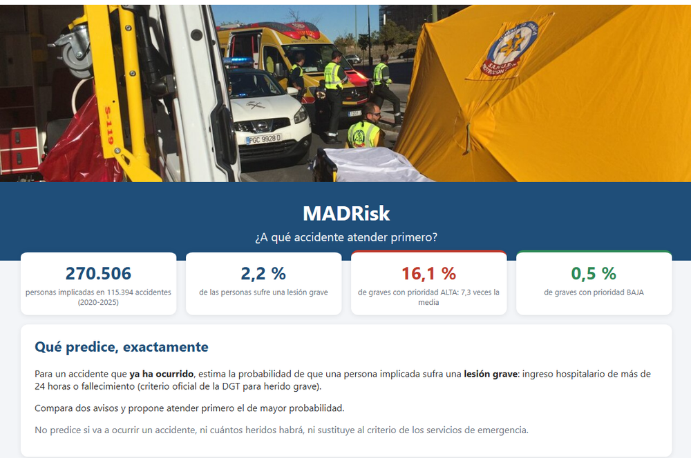
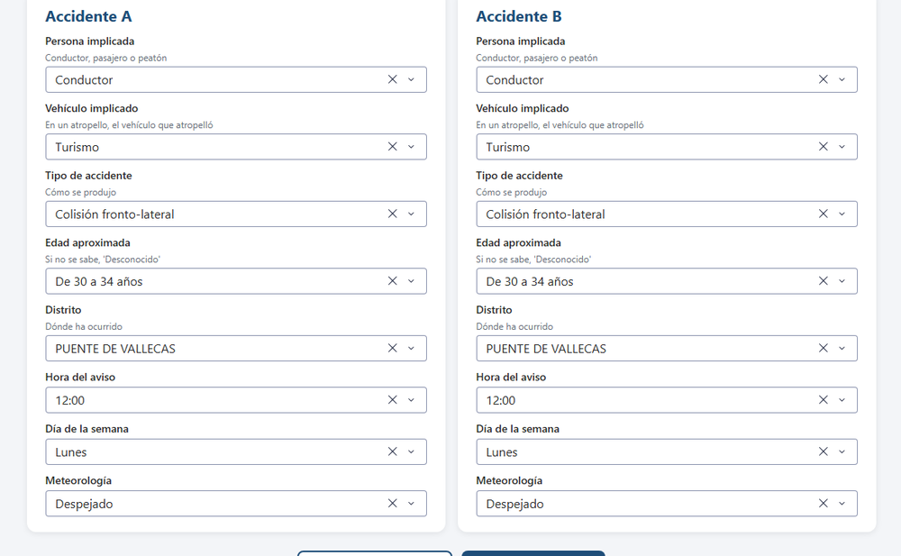
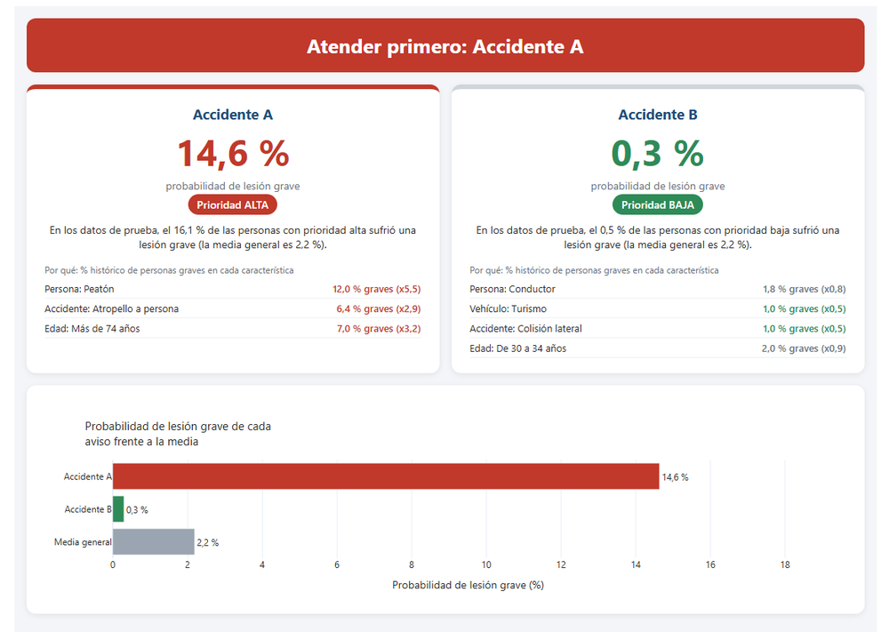
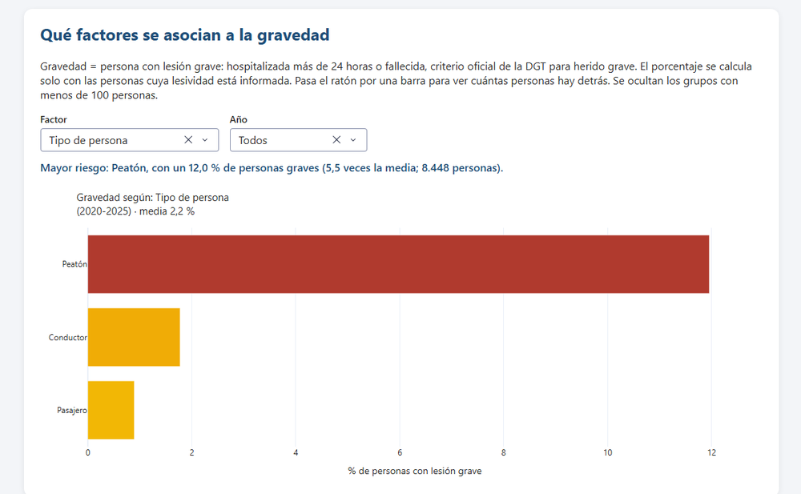
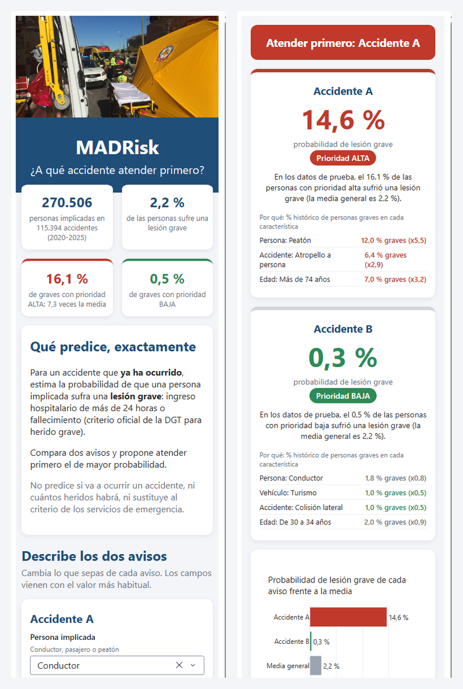
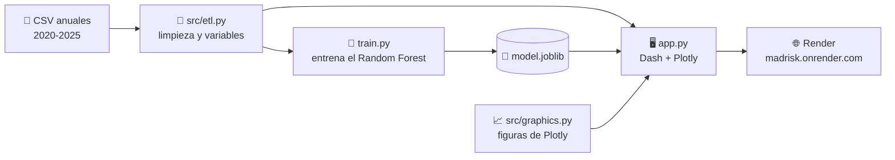

<div align="center">

# 🚑 MADRisk

### ¿A qué accidente de tráfico atender primero?

**Compara dos avisos de accidente en Madrid y descubre cuál tiene más probabilidad de lesión grave.**

[](https://madrisk.onrender.com/)




</div>

---

## 🎯 ¿Para qué sirve?

Cuando llegan **dos avisos de accidente a la vez**, un servicio de emergencias tiene que decidir a cuál acudir primero. MADRisk ayuda a ordenar esa decisión con datos: a partir de lo que se sabe al recibir el aviso (quién está implicado, en qué vehículo, qué tipo de accidente, dónde y cuándo), estima la **probabilidad de que una persona implicada sufra una lesión grave** y propone atender primero el aviso con mayor riesgo.

> **Un ejemplo.** Aviso A: un peatón de más de 74 años atropellado de noche. Aviso B: el conductor de un turismo en un choque lateral por la mañana.
> MADRisk estima un **14,6 %** de probabilidad de lesión grave para A frente a un **0,3 %** para B, y recomienda atender primero el **Accidente A**.

La app se basa en **270.506 personas implicadas en 115.394 accidentes** de Madrid entre 2020 y 2025.

> [!IMPORTANT]
> MADRisk estima la gravedad de un accidente **que ya ha ocurrido**. **No** predice si va a ocurrir un accidente, ni cuántos heridos habrá, ni sustituye al criterio de los servicios de emergencia. Es un proyecto académico con datos abiertos, no una herramienta oficial.

---

## ✨ Qué hace la app

### 1. Compara dos avisos y decide cuál atender primero

Se describe cada aviso con ocho datos que se conocen nada más recibirlo. Los desplegables vienen con el valor más habitual, así que solo hay que cambiar lo que se sepa. El botón **«Cargar un ejemplo»** rellena dos avisos contrastados para probar la herramienta con un clic.

<div align="center">

</div>

| Dato del aviso | Ejemplo |
| --- | --- |
| Persona implicada | Conductor, pasajero o peatón |
| Vehículo implicado | Turismo, moto > 125 cc, bicicleta… (en un atropello, el que atropelló) |
| Tipo de accidente | Colisión lateral, atropello a persona, caída… |
| Edad aproximada | De 30 a 34 años, Más de 74 años… |
| Distrito | Los 21 distritos de Madrid |
| Hora y día de la semana | 22:00, viernes |
| Meteorología | Despejado, lluvia débil… |

### 2. Un resultado que se entiende de un vistazo

Al pulsar **«Comparar avisos»** aparece el veredicto en grande, la probabilidad de cada aviso con su **nivel de prioridad** (alta, media o baja) y un gráfico que la compara con la media. Cada aviso incluye un bloque **«Por qué»** con el porcentaje histórico de personas graves en cada característica elegida, para que el resultado no sea una caja negra.

<div align="center">

</div>

Si los dos avisos tienen el mismo nivel de prioridad y probabilidades casi iguales, la app lo dice (*«Prioridad similar: decide el criterio del operador»*) en lugar de forzar una respuesta.

### 3. Los datos que respaldan el modelo

Tras el botón **«Ver los datos detrás del modelo»** se encuentra el análisis que justifica las estimaciones:

- **Qué factores se asocian a la gravedad.** Porcentaje de personas con lesión grave según el factor elegido (hora, día, mes, distrito, tipo de accidente, vehículo, persona, edad, sexo, meteorología, alcohol), con filtro por año. Una frase resume el grupo de mayor riesgo, por ejemplo: *«Peatón, con un 12,0 % de personas graves (5,5 veces la media)»*.
- **Exploración de los accidentes** (plegada al abrir la web). Nueve gráficos con filtros por año, mes, día, hora, distrito, tipo de accidente, vehículo, meteorología y lesividad: accidentes por mes, día de la semana, hora, mapa de calor día × hora, distritos, tipos de accidente, meteorología, vehículos y lesividad. Cada gráfico indica si cuenta **accidentes** o **personas**.

<div align="center">

</div>

### 4. También en el móvil

La web se adapta a pantallas pequeñas: las cifras clave pasan a una cuadrícula de 2 × 2, los filtros se colocan por parejas, los títulos de los gráficos se parten en líneas y los márgenes se ajustan al ancho disponible.

<div align="center">

</div>

---

## 🧠 El modelo

### Qué estima y cómo se define «grave»

Para **una persona implicada en un accidente ya ocurrido**, el modelo estima la probabilidad de que sufra una **lesión grave**: ingreso hospitalario de más de 24 horas o fallecimiento a las 24 horas. Es el criterio oficial de la **DGT** para «herido grave».

Las personas con la lesividad vacía o «Se desconoce» (**el 45,6 % de las filas**) no se tratan como «sin lesión»: quedan fuera del entrenamiento y de los porcentajes. Por eso el modelo se entrena con **147.075 personas**, de las que solo el **2,2 %** tiene una lesión grave.

### Cómo se entrena

- **Algoritmo:** Random Forest (50 árboles, profundidad 8), comparado con una regresión logística de base.
- **Variables:** las ocho que se conocen al recibir el aviso (tipo de persona, vehículo, tipo de accidente, edad, distrito, hora, día de la semana y meteorología). Se descartaron el sexo, el alcohol y el mes porque no se saben al recibir el aviso o no aportan, y se comprobó que el modelo rinde igual sin ellos. `lesividad` y `cod_lesividad` **nunca** se usan como predictor porque contienen la misma información que el objetivo.
- **Evaluación:** 70 % entrenamiento y 30 % prueba, con `random_state=42` y manteniendo la proporción de graves en ambos.
- El modelo se entrena **una sola vez** con `train.py` y se guarda en `model.joblib` (~1,4 MB). La app solo lo carga: nunca entrena.

### Qué tan bien funciona (datos de prueba)

Como solo el 2,2 % de las personas es grave, la *accuracy* no sirve (decir siempre «no grave» acierta el 97,8 %). Lo que importa es que el modelo **ordena bien el riesgo**:

| Prioridad | Probabilidad estimada | Personas de prueba | Lesión grave en la realidad |
| :---: | :---: | ---: | :---: |
| 🔴 **Alta** | ≥ 8 % | 1.987 | **16,1 %** |
| 🟠 **Media** | 3 – 8 % | 8.574 | **5,6 %** |
| 🟢 **Baja** | < 3 % | 33.562 | **0,5 %** |

Con prioridad alta hay **7,3 veces más** lesiones graves que la media (2,2 %), y con prioridad baja, 4 veces menos. El 10 % de personas con mayor probabilidad concentra un 12,3 % de graves.

> [!NOTE]
> Es una **estimación orientativa**, no precisa para un caso individual: con un umbral de 0,08, la clase grave obtiene un recall de 0,33, una precisión de 0,16 y un F1 de 0,22. Aun con prioridad alta, la mayoría de las personas no sufre una lesión grave. Con el umbral habitual de 0,5 el modelo no detecta ningún grave, así que la app muestra la **probabilidad** y la compara con la media en lugar de dar un sí o un no.

---

## 📊 Los datos

Fuente: **Portal de Datos Abiertos del Ayuntamiento de Madrid**, conjunto *«Accidentes de tráfico de la Ciudad de Madrid»*, ficheros anuales de **2020 a 2025** (2026 se deja fuera porque el año está incompleto).

- Cada fila es **una persona o vehículo implicado**, no un accidente: un mismo `num_expediente` se repite. Para contar accidentes se cuentan expedientes distintos, nunca filas.
- Campos usados: fecha y hora, distrito, tipo de accidente, meteorología, tipo de vehículo, tipo de persona, rango de edad, sexo, lesividad, alcohol y drogas. Las coordenadas están en los datos, pero la app no las usa.
- El ETL normaliza los nombres de columna, convierte los «NULL» en nulos, valida cada año (imprime filas válidas e inválidas) y crea las variables derivadas: año, mes, día, hora, día de la semana, franja horaria y fin de semana.

---

## 🏗️ Cómo está construido



```text
MADRisk/
├── app.py            # layout y callbacks de Dash; solo carga el modelo, nunca lo entrena
├── train.py          # entrena, evalúa y guarda model.joblib
├── model.joblib      # Random Forest entrenado (50 árboles, profundidad 8, ~1,4 MB)
├── src/
│   ├── etl.py        # carga, limpieza y variables derivadas
│   ├── model.py      # codificación, entrenamiento, evaluación y predicción
│   └── graphics.py   # funciones que reciben datos y devuelven figuras de Plotly
├── tests/            # pruebas del ETL, del modelo y de los gráficos
├── data/raw/         # CSV anuales 2020-2025 del Ayuntamiento de Madrid
├── assets/carrusel/  # fotos de la cabecera
├── docs/img/         # capturas de este README
├── requirements.txt  # dependencias
├── Procfile          # arranque con gunicorn
├── render.yaml       # configuración del despliegue en Render
└── runtime.txt       # versión de Python
```

<details>
<summary><b>Decisiones de diseño</b></summary>

- **Los datos se cargan una sola vez** al arrancar la app, no en cada callback.
- **`graphics.py` no sabe nada de Dash:** recibe datos y devuelve figuras, por lo que se puede probar y reutilizar por separado.
- **El plan gratuito de Render tiene 512 MB de RAM:** solo se cargan las columnas necesarias y el modelo se limita en tamaño. Con 50 árboles de profundidad 8 el fichero pesa 1,4 MB y rinde igual que con 100 árboles de profundidad 12 (13,8 MB).
- **Gráficos coherentes:** todos comparten paleta (azules y los amarillos, naranjas y rojos de los chalecos del SAMUR) y distinguen accidentes de personas.
- **Adaptación a móvil con `clamp()` y `min()`** dentro de `style={}`, sin hojas de estilo adicionales.

</details>

---

## 🚀 Ejecutarlo en local

```bash
git clone https://github.com/paofdezcheca/MADRisk.git
cd MADRisk
python -m venv .venv
.venv\Scripts\activate        # en Linux/Mac: source .venv/bin/activate
pip install -r requirements.txt
python app.py
```

Después, abre http://127.0.0.1:8050 en el navegador.

Para volver a entrenar el modelo y ver sus métricas: `python train.py`.

### Tests

Comprueban el ETL, el modelo y los gráficos con datos inventados (no hace falta instalar nada más):

```bash
python tests/test_etl.py
python tests/test_model.py
python tests/test_graphics.py
```

---

## 🗺️ Fases del proyecto

| Fase | Contenido | Estado |
| --- | --- | :---: |
| 1. Preparación de los datos | Integración de los ficheros anuales, limpieza y tratamiento de nulos | ✅ |
| 2. Análisis exploratorio | Evolución, distribución y patrones de la accidentalidad | ✅ |
| 3. Modelo predictivo | Variable objetivo, variables explicativas, entrenamiento y evaluación | ✅ |
| 4. Aplicación | Visualizaciones con Plotly y dashboard con Dash | ✅ |
| 5. Despliegue y mejora | URL pública en Render, tests, versión para móvil y mejora continua | ✅ |

---

## 🛠️ Tecnologías

Python · pandas · NumPy · scikit-learn · joblib · Plotly · Dash · gunicorn · Git y GitHub · Render

## 📸 Créditos de las fotos

Las fotos del carrusel son del **Diario de Madrid**, publicadas en Wikimedia Commons con licencia [CC BY 4.0](https://creativecommons.org/licenses/by/4.0/):

- [Accidente de moto en la calle Antonio Machado](https://commons.wikimedia.org/wiki/File:Accidente_de_Moto_en_la_calle_Antonio-Machado-29.03.08.jpg)
- [Intervención del SAMUR en un accidente de tráfico](https://commons.wikimedia.org/wiki/File:Intervenci%C3%B3n_del_SAMUR_en_un_accidente_de_Tr%C3%A1fico.jpg)
- [Intervención del SAMUR en un accidente de moto en la M30](https://commons.wikimedia.org/wiki/File:Intervenci%C3%B3n_del_SAMUR_en_un_accidente_de_moto_en_la_M30.jpg)
- [Intervención del SAMUR en un accidente de moto](https://commons.wikimedia.org/wiki/File:Intervenci%C3%B3n_del_SAMUR_en_un_accidente_de_moto.jpg)
- [Intervención del SAMUR en un atrapado en un accidente de tráfico](https://commons.wikimedia.org/wiki/File:Intervenci%C3%B3n_del_SAMUR_en_un_atrapado_en_una_accidente_de_tr%C3%A1fico.jpg)

---

<div align="center">

Proyecto académico de la asignatura *Desarrollo de Aplicaciones para la Visualización de Datos* (ICAI).
Datos abiertos del Ayuntamiento de Madrid. No es una herramienta oficial.

</div>
